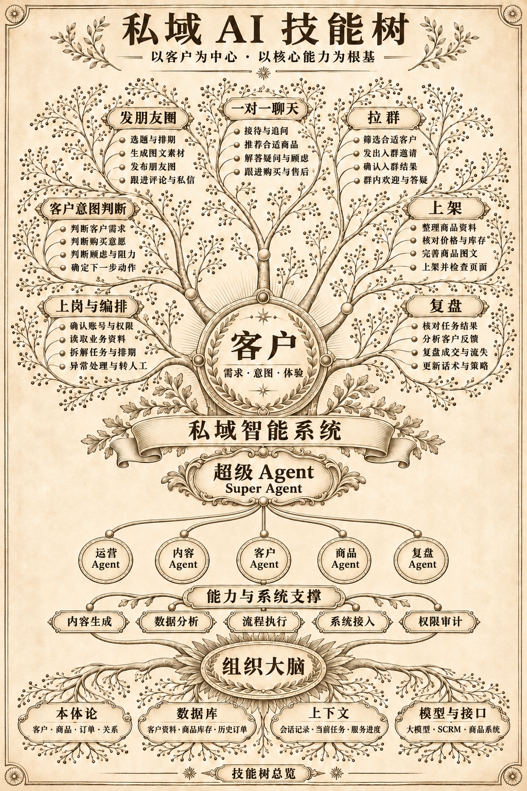

# WeChat-AI-Skills

**私域智能系统 · 客户 Agent 的上岗与运营技能库**

围绕客户的需求、意图与体验，把业务判断、内容准备、系统操作和结果核对整理成客户自己的 Agent 可以安装使用的技能。

**当前版本：v1.2.1 · 2026-11-13。** 在 v1.2.0 的 15 项技能、七类目录、28 个节点和六个角色基础上，合并 A卷上岗原则：事实洁癖、第一性原理、对抗式审查。节点包含部分覆盖及待建设能力，详见[技能树总览](docs/skill-tree-overview.md)和[能力状态](docs/capability-status.md)。

[开始安装](docs/quickstart.md) · [正式版本](https://github.com/WeChat-AI-Skills/private-domain-ai-skills/releases/latest) · [第一次演练](.agents/skills/private-domain-ops/references/examples/first-task.md) · [文档目录](docs/README.md)

## 给客户 Agent 的安装指令

> 请阅读 https://github.com/WeChat-AI-Skills/private-domain-ai-skills 的 README 和 docs/quickstart.md，安装固定版本 v1.2.1 的完整 15 项技能。保留我已有技能和修改，核对宿主是否识别。然后使用 private-domain-ops 完成随包 first-task 合成演练，返回草稿、使用的角色与技能、素材状态和缺口。没有实际业务授权时，不发送、不发布、不邀请。

公开浏览和下载无需 GitHub 登录。首个适配宿主是 Codex；其他 Agent/Cortex 等宿主需单独核对技能目录、识别和使用结果。安装包不包含业务账号或私有运行服务依赖；实际执行使用客户自己的工具、资料与授权。

## 技能树总览

这张图展示完整产品方向；下表及能力状态说明当前能做到哪一步。

| 七类能力 | 入口与当前范围 |
| --- | --- |
| [上岗与编排](docs/domains/01-onboarding.md) | 环境检查、任务路由、职责与交接 |
| [客户意图判断](docs/domains/02-intent.md) | 复用接待和档案中的判断，独立判断产物待扩展 |
| [发朋友圈](docs/domains/03-moments.md) | 图文与排期方法、提交与回读规范；现场执行需适配 |
| [一对一聊天](docs/domains/04-chat.md) | 接待、档案、跟进与答复；按真实商品和服务规则执行 |
| [拉群](docs/domains/05-groups.md) | 现有群邀请、名单和成员核对；群内执行待扩展 |
| [上架](docs/domains/06-listing.md) | 当前为规划节点；商品角色可整理提供的资料与缺口，真实上架未交付 |
| [复盘](docs/domains/07-review.md) | 任务回执核对、反馈分析与规则候选 |

## Super Agent 怎样使用这些技能

Super Agent 负责目标、选择路径、必要分工和总结果。运营、内容、客户、商品、复盘五个专业角色直接向它返回结果。简单任务可直接调用技能；复杂任务使用相关角色，无需每次全部参与。

默认可在一个会话中按职责执行。只有宿主实际支持且任务允许时才委派子 Agent；角色文件不会自动启动五个进程。参见[角色与系统架构](docs/architecture.md)。

## 上岗原则

所有技能入口与六份角色职责接入同一份[A卷](.agents/skills/private-domain-ops/references/a-volume-onboarding.md)。轻任务用简短判断，高风险动作保留独立审查与人工签核证据；有效授权继续复用。新任务/结果卡 1.1 记录风险、三关依据和未核实项，继续读取 1.0 卡片。检查器只校验结构，不替代实际审查或业务授权。

## 15 项可安装技能

| 主要用途 | 技能 |
| --- | --- |
| 上岗与总控 | [private-domain-ops](.agents/skills/private-domain-ops/SKILL.md)、[wechat-scrm-onboarding](.agents/skills/wechat-scrm-onboarding/SKILL.md) |
| 客户接待与档案 | [customer-intake](.agents/skills/customer-intake/SKILL.md)、[customer-profile](.agents/skills/customer-profile/SKILL.md) |
| 跟进与消息 | [followup-plan](.agents/skills/followup-plan/SKILL.md)、[wechat-scrm-friend-message](.agents/skills/wechat-scrm-friend-message/SKILL.md) |
| 朋友圈 | [moments-calendar](.agents/skills/moments-calendar/SKILL.md)、[wechat-scrm-moments](.agents/skills/wechat-scrm-moments/SKILL.md) |
| 活动与群邀请 | [campaign-invite](.agents/skills/campaign-invite/SKILL.md)、[wechat-scrm-group-invite](.agents/skills/wechat-scrm-group-invite/SKILL.md)、[wechat-activity-customer-handoff](.agents/skills/wechat-activity-customer-handoff/SKILL.md)、[audit-youzan-cart-nonbuyers](.agents/skills/audit-youzan-cart-nonbuyers/SKILL.md) |
| 结果与复盘 | [task-reconcile](.agents/skills/task-reconcile/SKILL.md)、[sales-review](.agents/skills/sales-review/SKILL.md) |
| 扩展维护 | [wechat-scrm-friend-cleanup](.agents/skills/wechat-scrm-friend-cleanup/SKILL.md)，仅按具体授权使用 |

## 使用与持续迭代

先完成[合成演练](.agents/skills/private-domain-ops/references/examples/first-task.md)，再按[客户环境卡](.agents/skills/wechat-scrm-onboarding/references/customer-setup.md)只读上岗。实际任务需要在客户环境核对工具、账号、对象和有效授权；草稿、排期、实际发布和客户结果分别报告。

本仓库是唯一正式发布入口，由 Codex 统一维护。客户资料、凭据、原始对话和运行回执保存在客户工作区。反馈提供版本、场景、预期、实际结果和脱敏复现步骤；升级保留客户修改。

[版本变化](CHANGELOG.md) · [能力状态](docs/capability-status.md) · [迭代路线](docs/iteration-roadmap.md) · [安装清单](manifest.json) · [许可与素材范围](NOTICE.md)
