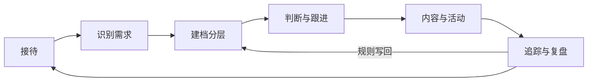
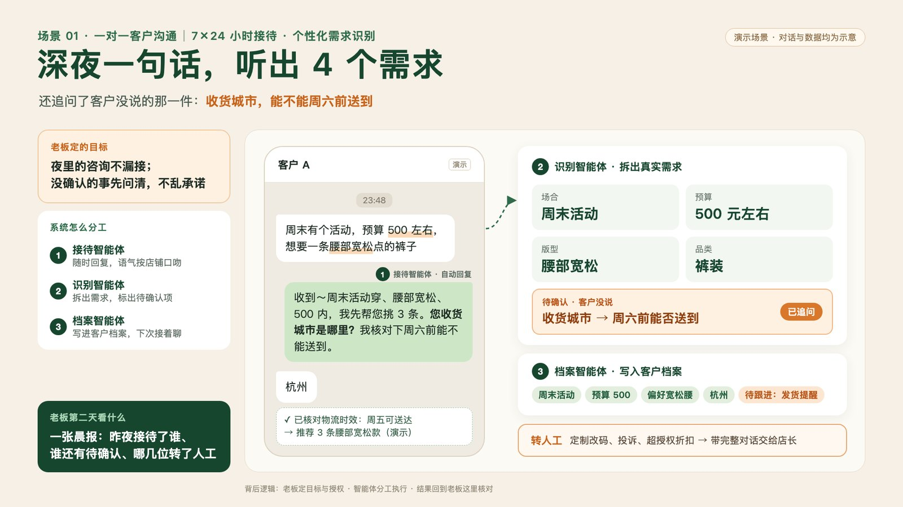

# 私域智能运营 Skills

**把销冠的判断，变成团队可执行的技能。**

一套面向微信私域的 Agent Skills：接待、识别需求、建档分层、跟进、朋友圈、活动拉群、复盘。
每个技能遵循同一套规矩——先看证据，再给判断；该问的清清楚，该转人的转人；不替老板做承诺。


---

## 为什么做这套东西

私域最常见的失败不是没流量，是流量来了接不住。

- **获客便宜了，转化却掉了。** 新客大量涌进来，接待还是靠人盯；人一忙，深夜的咨询就烂在列表里。
- **SOP 发下去没人读。** 读了也不在聊天的当下用不出来——真正难的是判断，不是话术。
- **销冠的判断留在脑子里。** 什么时候追问、什么话不能说、哪条线索该放一放，很少有人写下来。人一走，跟进就断档。
- **通用 AI 不懂业务。** 它不懂你的产品，不懂你的客户，更不懂私域的分寸。

这套 Skills 解的不是"多写几句销售话术"，而是把**判断过程**写下来：看到什么信号、缺什么信息、下一步做什么、什么情况下停、什么情况下交给谁。

## 它怎么工作

私域是一个闭环，不是一串工具：



三层分工：

| 层 | 谁 | 做什么 |
| --- | --- | --- |
| 目标与授权 | 老板 / 私域负责人 | 定目标、定边界、发布前确认、例外裁决 |
| 判断与执行 | 智能体（本仓库的技能） | 按规则接待、分层、起草、核对、复盘 |
| 事实与记录 | 客户档案 / 对话 / 订单 | 提供上下文，留下证据 |

> 老板定目标和授权，智能体分工执行，结果回到老板核对。

技能本身**不登录微信、不发送消息**。它产出的是判断、草稿和待办；发送与发布由人或已授权的系统执行。

## 七个技能

| 技能 | 解决什么 | 典型触发 |
| --- | --- | --- |
| [private-domain-ops](skills/private-domain-ops/) | 总控：判断现在该做哪一步，守住授权边界 | "今天私域该做什么" "这条消息能发吗" |
| [customer-intake](skills/customer-intake/) | 一对一接待：从对话里拆需求，标待确认项 | 深夜咨询、问尺码/库存/发货、"随便看看" |
| [customer-profile](skills/customer-profile/) | 建档与分层：统一标签，识别阶段与优先级 | 对话结束、活动前、交接前 |
| [followup-plan](skills/followup-plan/) | 跟进：给由头、排时机、设停止条件 | "这个客户三天没回了" "排一下本周跟进" |
| [moments-calendar](skills/moments-calendar/) | 朋友圈：一句目标排一周，发布前核对 | "本周主推新品" "别刷屏" |
| [campaign-invite](skills/campaign-invite/) | 活动拉群：先筛人、再分层、同意才进群 | 试穿会、答疑、限时活动 |
| [sales-review](skills/sales-review/) | 复盘：从对话与结果里提炼可写回的规则 | 周末复盘、新人培训、话术失效 |

## 走一遍：23:48 的一条咨询

客户发来一句话：

> 周末有个活动，预算 500 左右，想要一条腰部宽松点的裤子

`customer-intake` 不急着推荐，先把一句话拆成可执行的东西：

| 维度 | 内容 |
| --- | --- |
| 已知 | 场合：周末活动 · 预算：500 · 偏好：腰部宽松 · 品类：裤装 |
| 推断 | 更看重舒适与版型，不是价格敏感型（依据：先给预算再提版型） |
| 待确认 | 收货城市——决定周六前能不能到 |
| 建议回复 | "收到～周末活动穿、腰部宽松、500 内，我先帮您挑 3 条。您收货城市是哪里？我核对下周六前能不能送到。" |
| 风险 | 时效未确认，不能说"能到" |
| 动作 | 追问城市 → 核对物流 → 推荐 3 条 → 写入档案 |

同一套动作，换成美业、教育、2B 咨询也能用：**先拆需求，再谈方案；先确认，再承诺。**



## 安装

### Claude Code

```bash
git clone https://github.com/WeChat-AI-Skills/wechat-private-domain-skills.git
cd wechat-private-domain-skills
./install.sh                 # 默认链接到 ~/.claude/skills
```

只装一个技能：

```bash
cp -R skills/customer-intake ~/.claude/skills/
```

### Codex 或其他宿主

```bash
./install.sh --target ~/.codex/skills
```

`install.sh` 默认用符号链接，仓库更新后技能同步更新；加 `--copy` 改为复制。

### 不安装也能用

把某个 `skills/<name>/SKILL.md` 连同它的 `references/` 一起粘贴给任意支持长上下文的模型。技能是纯文本，没有运行时依赖。

## 快速开始

装好之后，直接说人话：

1. 「客户说：'周末活动，500 左右，想要腰部宽松的裤子'。帮我判断需求、给回复、标出要追问的。」
2. 「这周主推秋季通勤新品，帮我排一周朋友圈，别刷屏。」
3. 「周六办试穿答疑，把想买裤子的人筛出来，分层邀约。」

技能会先确认三件事：**目标是什么、现在有哪些事实、哪些动作需要你点头。**

## 设计原则

1. **证据先于判断。** 每条结论分三类：`已知`（原话/记录）、`推断`（附依据）、`待确认`（附问题）。不把猜测写成事实。
2. **三档授权。** A 级可直接做（起草、建档、排期）；B 级需负责人确认（发送、发布、价格、库存时效承诺）；C 级必须转人工（投诉、定制、超授权、敏感问题）。
3. **人把关。** 技能负责把选项和风险摆到桌面上，决定权始终在人。
4. **可复盘。** 每次判断都能落成一张规则卡：触发条件、动作、话术、例外、证据。单案例不立规则。
5. **不假装有接口。** 没有工具时进入"离线模式"，输出可复制文本和执行清单；绝不编造客户 ID、发送结果或数据。

## 仓库结构

```text
.
├── skills/                 # 七个技能，每个自带 SKILL.md 与 references/
│   ├── private-domain-ops/
│   ├── customer-intake/
│   ├── customer-profile/
│   ├── followup-plan/
│   ├── moments-calendar/
│   ├── campaign-invite/
│   └── sales-review/
├── docs/
│   ├── method.md           # 运营闭环、12 件事与技能的映射
│   ├── boundaries.md       # 授权分级、转人工、数据与合规
│   └── tool-contract.md    # 可选系统接口契约（MCP）
├── examples/               # 合成数据的输入与期望输出
├── assets/                 # 演示图
├── scripts/validate_skills.py
└── install.sh
```

## 验证

```bash
python3 scripts/validate_skills.py
```

检查 frontmatter、命名规范、引用文件是否存在、是否有未完成占位符、入口文件长度，以及所有相对链接。

## 边界

这套技能**不做**这些事：

- 不登录微信、不自动加好友、不群发、不爬取、不绕过平台限制；
- 不替老板定价、承诺库存或时效、决定折扣；
- 不保存身份证、银行卡、完整住址等敏感信息；仓库内示例全部为合成数据；
- 不输出绝对化用语、虚假功效或诱导分享内容。

使用时应遵守微信平台规则与当地法律；营销内容发布前由负责人确认。

## 路线图

- **v0.2** 工具契约的参考实现（MCP server）
- **v0.3** 行业包：服饰 / 美业 / 教育 / 2B 咨询
- **v0.4** 评测集：把"好判断"变成可测的用例

## 许可

代码与技能文本采用 [MIT](LICENSE)。品牌名"悦榕"、演示图片与产品资料版权归其所有者，不在 MIT 授权范围内。

---

由 [悦榕 · 私域智能运营系统](https://github.com/WeChat-AI-Skills) 团队维护。
