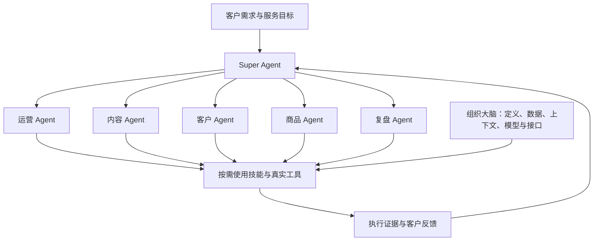

# 角色与系统架构

v1.2.0 将七类产品能力、角色职责与实际技能分开登记。客户需求、意图和体验是任务起点；能力目录负责发现，技能负责方法，真实工具负责操作，原系统证据说明结果。

五个专业角色均直接返回 Super Agent；需要另一专业支持时返回依赖请求，由总控分派。复盘角色的存在不等于独立审计，判断仍须依据实际证据。

| 角色 | 职责与读取入口 |
| --- | --- |
| Super Agent | [目标、路由、依赖、授权与总结果](../.agents/skills/private-domain-ops/references/agents/super-agent.md) |
| 运营 Agent | [环境、名单、现有群邀请与运营异常](../.agents/skills/private-domain-ops/references/agents/operations-agent.md) |
| 内容 Agent | [图文、素材状态、排期与发布核对](../.agents/skills/private-domain-ops/references/agents/content-agent.md) |
| 客户 Agent | [意图、接待、档案、跟进与售后交接](../.agents/skills/private-domain-ops/references/agents/customer-agent.md) |
| 商品 Agent | [商品资料与缺口；上架适配未交付](../.agents/skills/private-domain-ops/references/agents/product-agent.md) |
| 复盘 Agent | [逐对象结果、反馈和规则候选](../.agents/skills/private-domain-ops/references/agents/review-agent.md) |

## 两种执行方式

默认 single_agent：一个客户 Agent 按任务需要使用相关职责和技能。明确小任务可直达对应技能，不填写多余任务卡，不强制启用五个角色。

delegated：宿主确有委派、上下文隔离和结果回传能力，且任务范围允许时，由总控下发任务卡并接收结果。需要宿主单独验收，本包不启动服务、常驻进程或后台自动化。

角色图是职责关系。实际任务依赖不是图中七类能力的展示顺序；商品资料可能先于朋友圈准备，客户咨询也不必先做活动邀请。

## 安装与维护位置

- `.agents/skills/` 保留原 15 项平铺目录及相对引用。
- `private-domain-ops/references/catalog/skill-tree.json` 是七域、28 节点与主责技能映射的维护源。
- 同目录的 agent-registry.json 声明角色，workflow-registry.json 提供三条可裁剪工作流；它们不执行委派。
- 角色卡、任务规范、组织大脑规则、首次演练及目录查询脚本均在总控包内，完整安装后可离线读取。
- 根目录 manifest.json 是安装清单。其 registry_version=1.0 和旧 domain 字段保留兼容，product_catalog 指向新产品目录，不能把旧六域当成新导航。
- `docs/domains/`、技能树总览与设计文字清单由目录生成，修改目录后运行 `python3 scripts/build_catalog_docs.py`。

## 数据、执行与结果

使用[任务与结果约定](../.agents/skills/private-domain-ops/references/contracts/task-and-result.md)和[业务对象与上下文规则](../.agents/skills/private-domain-ops/references/brain/data-and-context.md)。工具能力名是抽象需求，必须映射到客户实际接口或页面。

任务 completed 可能只表示草稿完成；受理、排期、发布、入群、成交分别核对。逐对象操作结果沿用原结果契约 1.0；本次未增加商品发布动作。

客户既有数据、工具和模型服务可作为组织大脑的实际实现。公开仓库提供定义、模板及合成示例，客户运行数据留在客户环境；不强制另建私有后端。

## 从 v1.1.1 更新

技能数量、名称、安装路径、安装回执和结果契约保持兼容。总控包增加目录、角色、契约及示例，安装资源清单同步更新；现有客户修改仍由安装器阻止覆盖。新版明确指定旧清单分类与新产品目录各自用途。

执行 `--dry-run --update` 后再 `--update`。未修改的受管理副本可按同样方法回退到 v1.1.1；回退会移除本次新增的总控资料，先保存自己的任务产物。业务数据不属于安装目录，不随回退改动。详见[快速开始](quickstart.md)。
