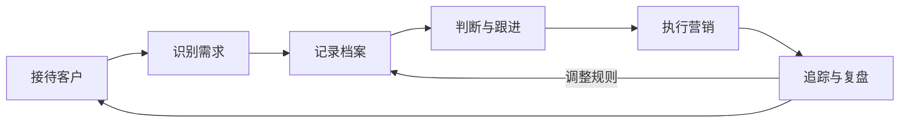

# 方法：一条可复盘的私域运营链路

这份文档说明技能背后的运营模型。技能是可执行的入口，模型解释"为什么这样分工"。

## 1. 五步闭环

| 步骤 | 输入 | 产出 | 对应技能 |
| --- | --- | --- | --- |
| 接待 | 客户消息、店铺口吻、可用库存 | 回复、追问、风险标记 | `customer-intake` |
| 识别 | 对话、订单、历史记录 | 需求四要素、阶段、信号强度 | `customer-intake` |
| 建档 | 上述结果 | 档案卡、标签、分层 | `customer-profile` |
| 跟进 | 档案、目标、频控 | 计划表、触达文案、停止条件 | `followup-plan` |
| 营销 | 一句话目标、商品、活动 | 排期、素材 brief、互动规则 | `moments-calendar` |
| 活动 | 客户池、权益、名额 | 分层名单、邀约、群议程、漏斗 | `campaign-invite` |
| 复盘 | 对话样本、结果数据 | 规则卡、反例、写回建议 | `sales-review` |

闭环的关键不是"每一步都有 AI"，而是**每一步的结果都会回到下一步**：接待产生的待确认项进入档案，档案决定跟进时机，跟进与活动的结果进入复盘，复盘产出的规则再写回档案与接待。

## 2. 三层结构

| 层 | 内容 | 归属 |
| --- | --- | --- |
| 私域组织大脑 | 业务本体（系统与配置）、业务上下文（目标、规则、客户状态）、业务数据（客户、商品、订单、互动） | 老板 / 负责人 |
| 专属智能体 | 业务能力（对话、内容、分析、编排）、工具与执行规则（调用、权限、转人工） | 智能体 + 负责人 |
| 运营闭环 | 接待、跟进、营销、复盘连成一条链路 | 全员 |

技能工作在第二层：它们不拥有数据，也不直接改系统；它们读上下文、给判断、产草稿，把"要不要执行"交回第一层。

## 3. "12 件事"与技能的映射

产品介绍里列了 12 件事。哪些是技能，哪些是系统能力，需要分清：

| # | 能力 | 由谁承担 | 说明 |
| --- | --- | --- | --- |
| 1 | 一对一接待 | `customer-intake` | 技能负责判断与草稿；发送由系统或人执行 |
| 2 | 识别个性化需求 | `customer-intake` | 四要素 + 待确认项 |
| 3 | 整理客户档案 | `customer-profile` | 档案卡与变更 diff |
| 4 | 给客户打标签 | `customer-profile` | 统一标签体系与分层 |
| 5 | 制定跟进计划 | `followup-plan` | 时机、由头、停止条件 |
| 6 | 执行客户跟进 | `followup-plan` + 系统 | 技能出文案与清单，发送需授权 |
| 7 | 生成营销素材 | `moments-calendar` | 文案与海报 brief |
| 8 | 发布朋友圈 | `moments-calendar` + 系统 | 发布前核对，B 级授权 |
| 9 | 商品上下架 | 系统 | 纯执行动作，不需要判断技能 |
| 10 | 追踪执行效果 | 系统 + `sales-review` | 数据由系统出，解读由技能做 |
| 11 | 复盘优化策略 | `sales-review` | 规则卡与写回建议 |
| 12 | 转交人工 | 所有技能 | 统一触发条件与交接卡 |

> 技能不替代系统。系统提供事实与执行通道，技能提供判断与表达，负责人提供目标与授权。

## 4. 角色与决策权

| 角色 | 决定什么 | 不做什么 |
| --- | --- | --- |
| 老板 | 目标、预算、价格与折扣、活动权益、发布确认 | 不逐条写话术 |
| 私域负责人 | 规则配置、日常抽查、例外裁决、复盘主持 | 不绕过授权改价 |
| 智能体 | 判断、草稿、清单、核对、提炼规则 | 不做承诺、不对外发送 |
| 客户 | 是否回复、是否进群、是否购买 | — |

一个重要原则：**授权是可以逐次收紧的**。新规则先影子运行（只记录不执行），稳定后再放开到 A 级；出现投诉或异常立即回到 B/C 级。

## 5. 规则从哪里来

规则不是拍脑袋写的，从三类材料里提炼：

1. **真实对话**：客户怎么问、销冠怎么答、哪一句之后客户沉默了。
2. **结果数据**：触达、回复、进群、下单，哪一步流失。
3. **复盘会**：团队认为"这次为什么成/为什么没成"。

提炼出来的规则必须写成规则卡（见 `sales-review/references/rule-card.md`），包含触发条件、动作、话术、例外、证据、置信度。**单案例不立规则**：至少 3 个相似案例，或 1 个强证据（如明确的客户拒绝原因）。

## 6. 看什么指标

不追求虚荣指标。每一层只看一个主指标和一个护栏指标：

| 环节 | 主指标 | 护栏指标 |
| --- | --- | --- |
| 接待 | 首次响应时长 | 错误承诺数 |
| 识别 | 待确认项补齐率 | 追问次数（别问太多） |
| 建档 | 档案完整率 | 标签冲突率 |
| 跟进 | 有效回复率 | 退订/拉黑数 |
| 内容 | 互动率（评论/私信） | 发布错误数 |
| 活动 | 进群率、到场率 | 投诉数 |
| 复盘 | 规则采纳率 | 规则回滚率 |

指标的分母要写清楚。没有数据的环节，宁可标"未知"，也不要用一个好看的估算填上。

## 7. 常见失败模式

| 现象 | 真实原因 | 对策 |
| --- | --- | --- |
| 客户不回 | 触达没有由头，或频率过高 | 每条消息先写"为什么现在找他" |
| 推荐不成交 | 需求没拆清就上方案 | 先补四要素，再给不超过 3 个选项 |
| 团队不用 | 技能输出太长、要人工再整理 | 输出固定为"结论 + 依据 + 下一步" |
| 规则失效 | 只沉淀了话术，没沉淀条件 | 规则卡必须写触发条件与例外 |
| 出事 | 授权边界模糊 | 明确 A/B/C，C 级一律转人工 |
