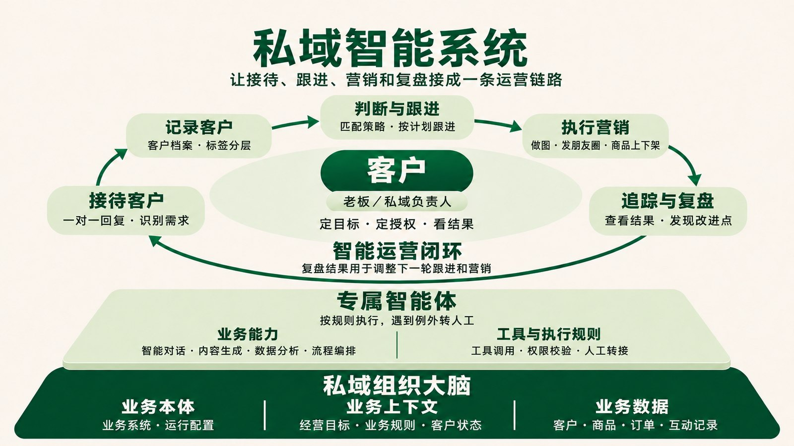
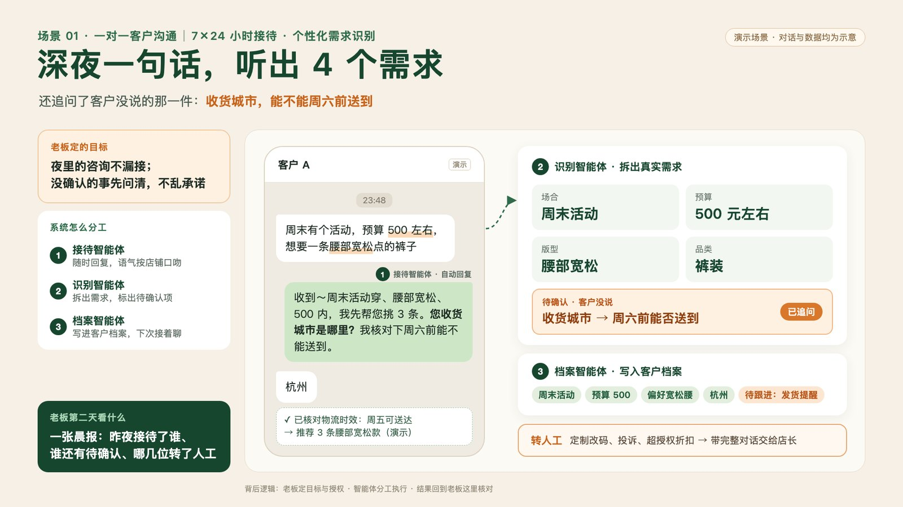
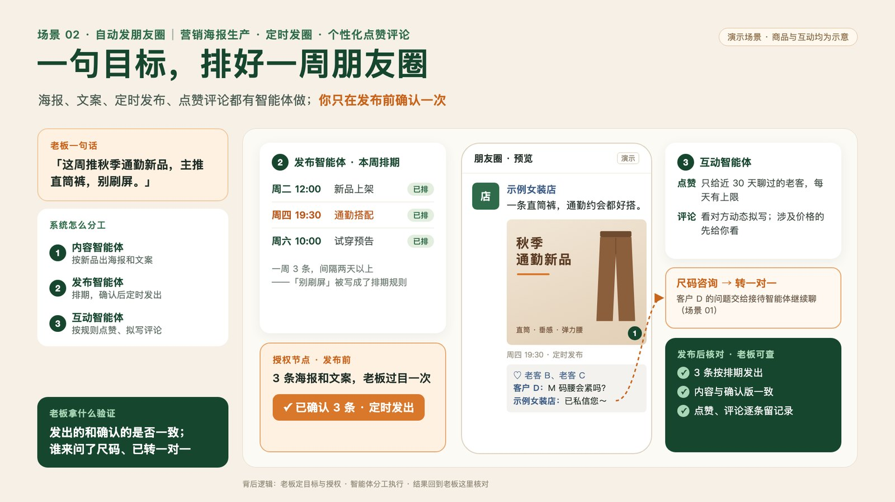
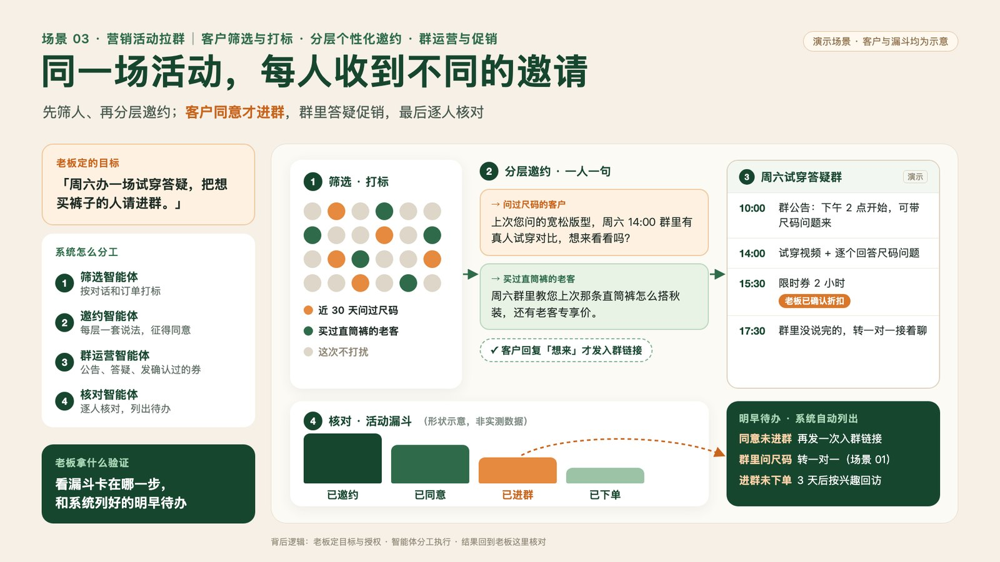

# 从接待到复盘

运营链路：接待与识别 → 档案与分层 → 跟进或内容/活动计划 → 已授权执行 → 核对结果 → 规则候选。

上图表达产品工作结构。图中的商品上下架等能力不代表本技能包已完成适配，实际状态见[能力状态](capability-status.md)。

| 产品工作 | 本包入口 | 当前交付范围 |
| --- | --- | --- |
| 一对一接待 | customer-intake | 需求分析与回复草稿，可衔接已授权通道 |
| 个性化需求识别 | customer-intake | 原话、推断、待确认分开 |
| 整理客户档案 | customer-profile | 档案和变更 diff |
| 标签分层 | customer-profile | 有依据的标签与分层建议 |
| 跟进计划 | followup-plan | 理由、内容、时间、停止条件 |
| 执行跟进 | wechat-scrm-friend-message | 客户环境核验后的操作流程 |
| 营销素材 | moments-calendar | 文案与素材需求，图像生成工具另行适配 |
| 发布朋友圈 | wechat-scrm-moments | 图文排期、修改、结果核对流程 |
| 商品上下架 | 后续适配 | 本包未提供执行技能 |
| 追踪效果 | sales-review | 基于可取得任务、互动及订单资料 |
| 复盘规则 | sales-review | 候选、证据、版本、回滚条件 |
| 人工交接 | private-domain-ops / 活动交接 | 工作卡、接手与处理回执 |

负责人决定目标与授权，Agent 复用事实执行，业务系统提供数据及真实通道。反馈按版本回到示例、技能或适配记录中。

## 场景演示素材

以下三图保留用于展示产品构想，图中人数、状态、承诺和排期均为演示，不能当成本版本运行证据。实际操作与验收以技能、客户规则和[合成案例](../examples/README.md)为准；例如“500 左右”应保留近似预算，不能直接改为“500 内”。

